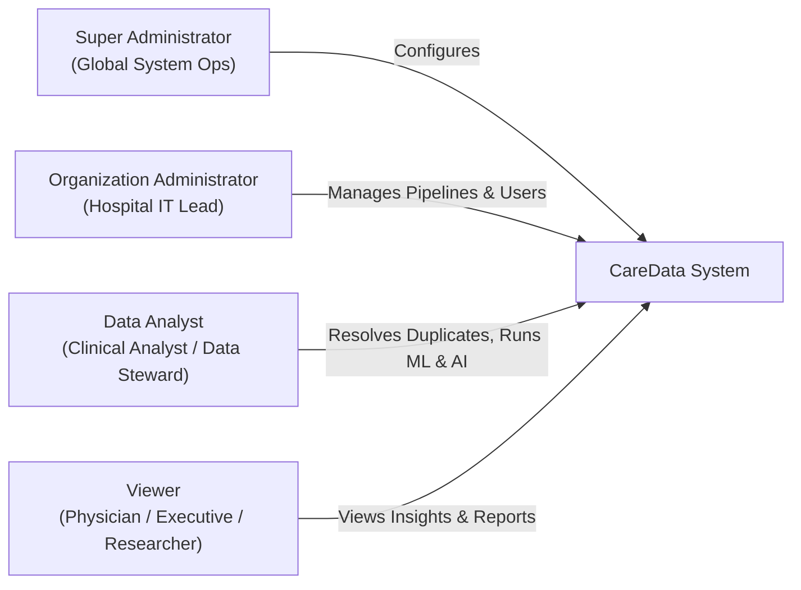
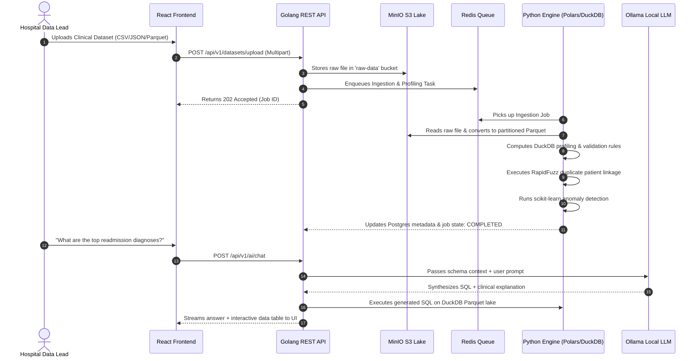
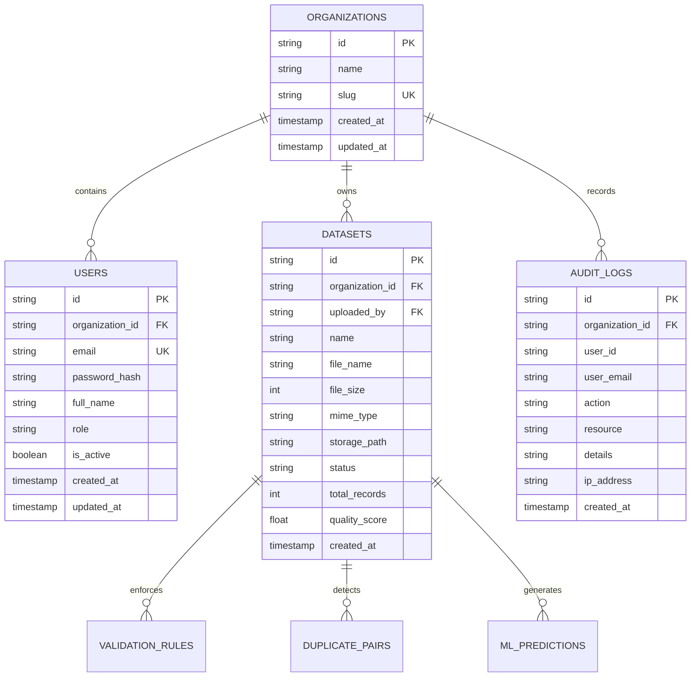

# Functional Specification Document (FSD)
# CareData Intelligence — AI-Enabled Healthcare Data Platform

**Document Version:** 1.0.0  
**Project Name:** CareData Intelligence  
**Status:** Approved / In Implementation  
**Target Audience:** Engineering, Product Management, Healthcare Data Stewards, Compliance Auditors  

---

## Table of Contents

1. [Document Overview & Objectives](#1-document-overview--objectives)
2. [Stakeholders & User Personas](#2-stakeholders--user-personas)
3. [System Architecture & Data Flow](#3-system-architecture--data-flow)
4. [Functional Requirements (FR)](#4-functional-requirements-fr)
   - [FR-01: Authentication, Multi-Tenancy & RBAC](#fr-01-authentication-multi-tenancy--rbac)
   - [FR-02: Data Ingestion & Raw Object Storage](#fr-02-data-ingestion--raw-object-storage)
   - [FR-03: Automated Data Profiling & Column Health](#fr-03-automated-data-profiling--column-health)
   - [FR-04: Healthcare Validation & Quality Rules Engine](#fr-04-healthcare-validation--quality-rules-engine)
   - [FR-05: Patient Deduplication & Record Linkage](#fr-05-patient-deduplication--record-linkage)
   - [FR-06: Healthcare Analytics & OLAP Query Engine](#fr-06-healthcare-analytics--olap-query-engine)
   - [FR-07: Machine Learning Anomaly Detection & Risk Stratification](#fr-07-machine-learning-anomaly-detection--risk-stratification)
   - [FR-08: AI-Powered Insights & Natural Language to SQL](#fr-08-ai-powered-insights--natural-language-to-sql)
   - [FR-09: Automated Clinical Reporting & Export](#fr-09-automated-clinical-reporting--export)
   - [FR-10: Pipeline Orchestration & Immutable Audit Logging](#fr-10-pipeline-orchestration--immutable-audit-logging)
5. [Data Models & Schema Specifications](#5-data-models--schema-specifications)
6. [API Interface Specifications](#6-api-interface-specifications)
7. [Non-Functional Requirements (NFR)](#7-non-functional-requirements-nfr)
8. [UI/UX Specifications](#8-ui-ux-specifications)

---

## 1. Document Overview & Objectives

### 1.1 Purpose
The purpose of this document is to specify the complete functional and technical behavior of the **CareData Intelligence** platform. This platform ingests, stores, profiles, validates, deduplicates, analyzes, and extracts AI-driven insights from complex healthcare datasets (electronic health records, claims, lab reports, and vitals).

### 1.2 Business Goals
- **Eliminate Data Silos**: Centralize raw clinical files into an indexed Parquet data lake.
- **Ensure Clinical Data Quality**: Prevent erroneous clinical diagnoses and billing rejections by automated rule validation.
- **Prevent Duplicate Medical Records**: Resolve duplicate patient demographic records with fuzzy matching to improve patient safety.
- **Accelerate Clinical Insights**: Provide sub-second query performance on massive datasets via DuckDB.
- **Democratize Healthcare Analytics**: Enable natural-language querying via private, local LLMs (Ollama).

---

## 2. Stakeholders & User Personas

### 2.1 User Roles Matrix

| Feature / Capability | Super Administrator | Organization Administrator | Data Analyst | Clinical Viewer |
| :--- | :---: | :---: | :---: | :---: |
| **Manage Organizations & System Flags** | ✅ | ❌ | ❌ | ❌ |
| **Provision & Manage Users** | ✅ (All Orgs) | ✅ (Own Org) | ❌ | ❌ |
| **Upload Raw Datasets & Ingestion** | ✅ | ✅ | ❌ | ❌ |
| **Configure Validation Rules & Pipelines** | ✅ | ✅ | ❌ | ❌ |
| **Review & Resolve Duplicate Patients** | ✅ | ✅ | ✅ | ❌ |
| **Execute ML Training & Risk Scoring** | ✅ | ✅ | ✅ | ❌ |
| **Natural Language AI Queries (Ollama)** | ✅ | ✅ | ✅ | ❌ |
| **View Analytics, KPI Dashboards & Reports** | ✅ | ✅ | ✅ | ✅ (Read-Only) |
| **Access Immutable Audit Trail** | ✅ (All Logs) | ✅ (Org Logs) | ❌ | ❌ |

---

## 3. System Architecture & Data Flow

---

## 4. Functional Requirements (FR)

### FR-01: Authentication, Multi-Tenancy & RBAC
- **FR-01.1**: The system shall authenticate users using JWT tokens (24-hour access token, 7-day refresh token).
- **FR-01.2**: Passwords shall be cryptographically hashed using **Bcrypt** (cost factor 10+) or Argon2.
- **FR-01.3**: The system shall isolate data strictly by `organization_id` (Multi-Tenancy).
- **FR-01.4**: Endpoints and UI navigation shall enforce the 4 specified RBAC roles (`SUPER_ADMIN`, `ORG_ADMIN`, `DATA_ANALYST`, `VIEWER`).

### FR-02: Data Ingestion & Raw Object Storage
- **FR-02.1**: The system shall support uploading healthcare datasets in CSV, JSON, Apache Parquet, and NDJSON formats up to 500MB per file.
- **FR-02.2**: Raw uploaded files shall be immutably stored in MinIO S3 object storage with unique storage keys: `raw-data/{org_id}/{dataset_id}/{timestamp}_{filename}`.
- **FR-02.3**: Uploaded datasets shall be automatically parsed and converted into compressed columnar **Apache Parquet** partitions (`snappy`/`zstd` compression).
- **FR-02.4**: The system shall track ingestion lifecycle status: `PENDING` → `PROCESSING` → `READY` (or `FAILED` with error diagnostics).

### FR-03: Automated Data Profiling & Column Health
- **FR-03.1**: Upon ingestion, the Python/DuckDB engine shall generate column-level profiling metrics:
  - Total row and column counts
  - Missing/Null value count and percentage
  - Unique value count (cardinality)
  - Data type inference (String, Integer, Float, Date, Timestamp, Boolean)
  - Numeric distributions: Min, Max, Mean, Median, StdDev, 25th/75th percentiles
- **FR-03.2**: The system shall compute an aggregated **Data Quality Index (0–100%)** for the dataset.

### FR-04: Healthcare Validation & Quality Rules Engine
- **FR-04.1**: The system shall validate records against configurable clinical data rules:
  - **Mandatory Field Rule**: Flags nulls in critical identifiers (Patient MRN, Encounter Date, Provider NPI).
  - **Clinical Range Rule**: Flags vital signs outside physiological bounds (e.g., Systolic BP > 250 or < 50; Heart Rate > 220; Body Temp > 110°F).
  - **Format & Standards Rule**: Regex validation on ICD-10 diagnosis codes (`^[A-Z][0-9][0-9A-Z](\.[0-9A-Z]{1,4})?$`) and 10-digit National Provider Identifier (NPI).
  - **Temporal Logic Rule**: Validates that Discharge Date ≥ Admission Date and Date of Birth ≤ Current Date.
- **FR-04.2**: The system shall generate a downloadable Quality Audit Log listing all record violations with line numbers.

### FR-05: Patient Deduplication & Record Linkage
- **FR-05.1**: The engine shall identify duplicate patient records using **RapidFuzz** and demographic blocking algorithms.
- **FR-05.2**: Matching shall evaluate weighted scores across:
  - First Name & Last Name (Token Sort Ratio & Levenshtein)
  - Date of Birth (Exact / Transposed digit matching)
  - Phone Number & Address (Standardized string similarity)
  - Gender & Postal Code
- **FR-05.3**: Pairs exceeding confidence threshold (default > 0.80) shall appear in the **Duplicate Resolution UI**.
- **FR-05.4**: Authorized analysts can trigger actions:
  - `Merge Records`: Consolidates records into a Master Patient Index (MPI).
  - `Mark as Distinct`: Records are confirmed unique and ignored in future scans.

### FR-06: Healthcare Analytics & OLAP Query Engine
- **FR-06.1**: The platform shall provide interactive analytical visualizations for:
  - Encounter volumes over time (Inpatient, Outpatient, Emergency)
  - Average Length of Stay (ALOS) by clinical department
  - 30-Day Hospital Readmission rates
  - Top 10 primary diagnosis categories (ICD-10 breakdown)
  - Provider workload and patient age cohort distributions
- **FR-06.2**: Analytical queries shall execute directly on local Parquet files via **DuckDB**, achieving sub-second responses for millions of records.
- **FR-06.3**: An optional connector shall allow sync of aggregated metrics into **Snowflake** for enterprise data warehousing.

### FR-07: Machine Learning Anomaly Detection & Risk Stratification
- **FR-07.1**: The engine shall train an unsupervised **Isolation Forest** model to detect clinical anomalies:
  - Outlier hospital billing charges per Diagnosis Related Group (DRG)
  - Abnormal vital sign combinations signaling acute decompensation
- **FR-07.2**: The system shall compute a **Patient Risk Score (0–100)** categorizing patients into `Low`, `Moderate`, and `High Risk` tiers for 30-day readmissions.
- **FR-07.3**: The UI shall display key feature importance factors contributing to each patient's risk score.

### FR-08: AI-Powered Insights & Natural Language to SQL
- **FR-08.1**: The system shall integrate with local **Ollama** LLMs (e.g., `llama3`, `mistral`, `meditron`) without external third-party API dependencies.
- **FR-08.2**: Users can ask natural-language questions (e.g., *"How many diabetic patients were admitted last quarter with length of stay > 5 days?"*).
- **FR-08.3**: The AI engine shall convert questions into validated SQL, execute against DuckDB, and return both clinical narrative answers and tabular data.
- **FR-08.4**: The system shall generate automated narrative executive summaries from pipeline findings.

### FR-09: Automated Clinical Reporting & Export
- **FR-09.1**: Users shall be able to generate and export comprehensive Data Intelligence Briefs in PDF and CSV format.
- **FR-09.2**: Reports shall include Executive Summary, Data Quality Scorecards, Anomaly Summaries, and AI Recommendations.

### FR-10: Pipeline Orchestration & Immutable Audit Logging
- **FR-10.1**: All pipeline steps (`Ingestion -> Profiling -> Validation -> Deduplication -> ML Inference -> AI Synthesis`) shall be monitored with real-time state transitions in Redis.
- **FR-10.2**: Every state-changing user action (login, upload, rule modification, duplicate resolution, user creation) shall create an immutable audit record containing timestamp, user ID, IP address, resource, and delta.

---

## 5. Data Models & Schema Specifications

---

## 6. API Interface Specifications

| Method | Endpoint | Access Level | Description |
| :--- | :--- | :--- | :--- |
| `POST` | `/api/v1/auth/login` | Public | Authenticates user & returns JWT tokens |
| `POST` | `/api/v1/auth/register` | Public | Onboards organization & admin user |
| `POST` | `/api/v1/auth/refresh` | Public | Exchanges refresh token for new access token |
| `GET` | `/api/v1/auth/me` | Authenticated | Returns current authenticated user profile |
| `GET` | `/api/v1/users` | Admin+ | Lists all organization users |
| `POST` | `/api/v1/users` | Admin+ | Provisions a new user with role assignment |
| `GET` | `/api/v1/organizations` | Super Admin | Lists all tenant organizations |
| `GET` | `/api/v1/audit-logs` | Admin+ | Retrieves immutable audit event logs |
| `POST` | `/api/v1/datasets/upload` | Org Admin+ | Uploads and initiates raw dataset ingestion |
| `GET` | `/api/v1/datasets` | Analyst+ | Lists datasets with status and quality scores |
| `GET` | `/api/v1/datasets/{id}/quality` | All Roles | Fetches column profiling and validation report |
| `GET` | `/api/v1/duplicates` | Analyst+ | Lists pending duplicate patient match pairs |
| `POST` | `/api/v1/duplicates/resolve` | Analyst+ | Submits merge or separate resolution for candidate pair |
| `GET` | `/api/v1/analytics/kpis` | All Roles | Returns aggregated hospital KPIs and metrics |
| `POST` | `/api/v1/ai/chat` | Analyst+ | Natural language query to SQL and AI synthesis |
| `GET` | `/api/v1/health` | Public | System microservices health check |

---

## 7. Non-Functional Requirements (NFR)

### 7.1 Security & Compliance (HIPAA / GDPR)
- **Encryption at Rest**: AES-256 encryption on all MinIO storage buckets and PostgreSQL volumes.
- **Encryption in Transit**: TLS 1.3 encryption across all HTTP, Redis, and internal database connections.
- **Zero Third-Party PHI Exposure**: All AI processing runs through local Ollama LLMs with **no data sent to external cloud APIs**.
- **Audit Immutability**: Audit logs cannot be modified or deleted through the API.

### 7.2 Performance & Scalability
- **Analytical Query Latency**: Analytical queries on up to 10M rows must return in `< 1.5 seconds` using DuckDB.
- **API Response Time**: Core REST API metadata queries must respond in `< 50ms`.
- **Concurrent Ingestion**: System must support parallel file parsing without degrading frontend dashboard responsiveness.

### 7.3 Availability & Fault Tolerance
- **Graceful Degradation**: If Ollama or Redis is temporarily unreachable, the core analytics and dashboard remain fully functional.

---

## 8. UI/UX Specifications

### 8.1 Design Philosophy
- **Dark Mode Healthcare Theme**: Deep Slate `#0b0f19` background with high-contrast text and cyan/teal `#06b6d4` clinical accents.
- **Information Hierarchy**: Executive KPIs at the top, followed by interactive drill-down tables and visualizations.
- **Interactive Feedback**: Real-time progress bars during ingestion, micro-animations on hover, and clear status badges (`Operational`, `Pending`, `Resolved`).

---

## 9. Sign-off & Document Approval

| Role | Name | Signature / Status | Date |
| :--- | :--- | :--- | :--- |
| **Lead Architect** | Antigravity AI | Approved | 2026-08-26 |
| **Healthcare Product Lead** | CareData Team | Approved | 2026-08-26 |
