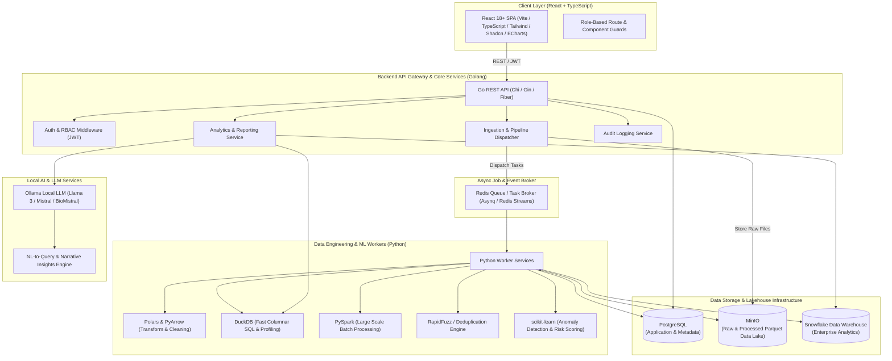

# CareData Intelligence — Phased Implementation Roadmap & Architecture Blueprint

## 1. Executive Overview

**CareData Intelligence** is an enterprise AI-enabled healthcare data intelligence platform. It provides end-to-end ingestion, raw storage, automated profiling, normalization, clinical validation, duplicate patient resolution, anomaly detection, predictive risk scoring, natural-language analytics, and AI-driven clinical reporting.

---

## 2. High-Level System Architecture



---

## 3. Technology Stack Breakdown

| Layer | Technology | Primary Purpose |
| :--- | :--- | :--- |
| **Frontend** | React 18+, TypeScript, Vite, TailwindCSS | Responsive, role-based healthcare intelligence dashboard |
| **Data Visualization** | ECharts / Recharts | High-performance interactive charts, distributions, and metrics |
| **Backend API** | Golang (Go 1.22+) | High-concurrency REST API, auth, business logic, orchestration |
| **Authentication** | JWT + Argon2 / Bcrypt | Secure token-based auth with refresh tokens and RBAC |
| **Application Database** | PostgreSQL 16 | Organizations, users, metadata, job state, validation rules, audit logs |
| **Async Task Broker** | Redis 7 (Asynq / Redis Streams) | Asynchronous pipeline execution and status tracking |
| **Data Lake** | MinIO (S3 Compatible) | Storing raw uploads, partitioned Parquet datasets, and artifacts |
| **Data Processing** | Python 3.11+, Polars, PyArrow | Fast dataframe transformations, normalization, schema enforcement |
| **SQL Analytics** | DuckDB | Blazing-fast embedded OLAP queries on local Parquet files |
| **Big Data Engine** | Apache Spark / PySpark | Scalable batch processing for massive healthcare datasets |
| **Fuzzy Matching** | RapidFuzz / RecordLinkage | Duplicate patient detection (Demographic fuzzy matching) |
| **Machine Learning** | scikit-learn, NumPy | Anomaly detection (Isolation Forest), readmission/risk scoring |
| **AI / LLM** | Ollama (Local Llama 3 / Mistral) | AI clinical summaries, natural-language query to SQL, automated reports |
| **Data Warehouse** | Snowflake (Optional Cloud Tier) | Enterprise warehouse sync for historical clinical reporting |
| **Containerization** | Docker, Docker Compose | Multi-container unified local and staging environment |

---

## 4. Role-Based Access Control (RBAC) Matrix

| Feature / Resource | Super Administrator | Organization Administrator | Data Analyst | Viewer |
| :--- | :---: | :---: | :---: | :---: |
| **Manage Organizations & System Settings** | ✅ Full Control | ❌ | ❌ | ❌ |
| **Manage Organization Users & Roles** | ✅ All Orgs | ✅ Own Org | ❌ | ❌ |
| **Configure AI / ML Global Parameters** | ✅ Full Control | ❌ | ❌ | ❌ |
| **View System-Wide Audit Logs** | ✅ All Orgs | ✅ Own Org Audit | ❌ | ❌ |
| **Connect Data Sources & Upload Datasets** | ✅ | ✅ | ❌ | ❌ |
| **Configure Validation Rules & Run Pipelines** | ✅ | ✅ | ❌ | ❌ |
| **Review & Resolve Duplicate Records** | ✅ | ✅ | ✅ | ❌ |
| **View Data Profiling & Quality Metrics** | ✅ | ✅ | ✅ | ✅ Read-only |
| **Run Advanced Analytics & Ask AI Questions** | ✅ | ✅ | ✅ | ❌ |
| **View Dashboards & Export Reports** | ✅ | ✅ | ✅ | ✅ |

---

## 5. Repository & Directory Structure Plan

```text
D3-care/
├── docker/
│   ├── docker-compose.yml          # Postgres, Redis, MinIO, Ollama, Backend, Frontend
│   └── minio-init/                 # MinIO default bucket initialization scripts
├── backend/                        # Golang REST API
│   ├── cmd/
│   │   └── api/
│   │       └── main.go             # API Server entry point
│   ├── internal/
│   │   ├── config/                 # Environment & Config parser
│   │   ├── database/               # Postgres connection, migrations (golang-migrate)
│   │   ├── domain/                 # Core entities, models, and interfaces
│   │   ├── handler/                # REST Controllers (Auth, Org, Dataset, Pipeline, etc.)
│   │   ├── middleware/             # Auth, RBAC, RateLimit, AuditLog, CORS
│   │   ├── repository/             # Database access layer (SQLc / GORM / pgx)
│   │   ├── service/                # Business logic
│   │   ├── queue/                  # Redis Asynq task producer
│   │   └── storage/                # MinIO S3 client wrapper
│   ├── go.mod
│   └── go.sum
├── data-engine/                    # Python Data Processing & ML Worker
│   ├── src/
│   │   ├── workers/                # Redis task consumer / job runner
│   │   ├── ingestion/              # File parsers (CSV, HL7, FHIR, JSON, Parquet)
│   │   ├── profiling/              # DuckDB + Polars dataset profiler
│   │   ├── cleaning/               # Normalization, type casting, null imputation
│   │   ├── validation/             # Rule-based healthcare record validators
│   │   ├── deduplication/          # Fuzzy patient matching (RapidFuzz)
│   │   ├── ml/                     # Anomaly detection & risk scoring models
│   │   ├── ai/                     # Ollama prompt orchestrator & NLQ translation
│   │   └── storage/                # MinIO Parquet reader/writer
│   ├── requirements.txt
│   └── pyproject.toml
├── frontend/                       # React + TypeScript Web App
│   ├── src/
│   │   ├── assets/                 # Brand assets, icons
│   │   ├── components/             # Reusable UI (Cards, Tables, Charts, Modals, Forms)
│   │   ├── context/                # AuthContext, ThemeContext, PipelineContext
│   │   ├── hooks/                  # Custom React hooks (useAuth, useFetch, useWebSocket)
│   │   ├── layouts/                # DashboardLayout, AuthLayout, Sidebar, Navbar
│   │   ├── pages/                  # Route views (Dashboard, Datasets, Quality, ML, AI, Admin)
│   │   ├── routes/                 # Protected route wrappers with RBAC checks
│   │   ├── services/               # Axios / Fetch API client functions
│   │   ├── types/                  # TypeScript interfaces and DTOs
│   │   ├── utils/                  # Formatters, clinical validators, constants
│   │   ├── App.tsx
│   │   └── main.tsx
│   ├── package.json
│   ├── tsconfig.json
│   └── vite.config.ts
├── docs/                           # API documentation, Schema specs, Architecture notes
└── README.md
```

---

## 6. Detailed Phase-by-Phase Roadmap

### 🚀 Phase 1: Foundation, Infrastructure & Core Authentication
**Goal:** Establish the foundational multi-service architecture, Dockerized local stack, Golang REST API, PostgreSQL database schema with migrations, and React + TypeScript dashboard shell with RBAC.

#### Deliverables:
1. **Infrastructure & Containerization**:
   - `docker-compose.yml` with PostgreSQL 16, Redis 7, MinIO, and Ollama.
   - Database migration scripts (`001_init_schema.up.sql`).
2. **Backend (Golang)**:
   - Configuration management via environment variables (`.env`).
   - Database connection pool (`pgx` / `sqlx`).
   - Domain models: `Organization`, `User`, `Role`, `AuditLog`.
   - Security: Password hashing with Argon2/Bcrypt, JWT Access + Refresh token flow.
   - RBAC Middleware for role-restricted endpoints.
   - REST Endpoints for Auth (`/api/v1/auth/login`, `/register`, `/refresh`, `/me`) and User/Org Management.
3. **Frontend (React + TypeScript)**:
   - Vite + React + TypeScript setup.
   - Design system setup (TailwindCSS, Lucide icons, Dark/Light mode support).
   - Global `AuthContext` with automatic token refresh interceptor.
   - Protected route architecture (`<ProtectedRoute allowedRoles={['SUPER_ADMIN', 'ORG_ADMIN']} />`).
   - Responsive Dashboard Layout (Collapsible Sidebar, Top Navbar with User Profile, Breadcrumbs).
   - Login, Register, User Management, and Organization Settings pages.

---

### 📂 Phase 2: Data Ingestion & Raw Lakehouse Storage
**Goal:** Allow users to upload heterogeneous healthcare datasets (CSV, JSON, Parquet, HL7-format representations), securely store raw files in MinIO, track dataset metadata in PostgreSQL, and orchestrate parsing jobs.

#### Deliverables:
1. **Backend (Golang & MinIO)**:
   - MinIO bucket initialization (`raw-data`, `processed-data`, `export-reports`).
   - Chunked / multipart file upload REST API (`POST /api/v1/datasets/upload`).
   - File metadata persistence in PostgreSQL (`datasets` table: size, mime_type, status, checksum).
   - Async job dispatcher: pushing ingestion jobs to Redis queue.
2. **Data Engine (Python & PyArrow/Polars)**:
   - Worker daemon listening to Redis queue tasks.
   - Automated file format detection, header extraction, and schema inference.
   - Conversion of raw uploads into standardized partitioned **Apache Parquet** files in MinIO.
3. **Frontend (React + TypeScript)**:
   - Drag-and-drop file upload zone with upload progress indicators.
   - Dataset catalog table with filtering, search, status tags (`Pending`, `Processing`, `Ready`, `Failed`), and download actions.
   - Dataset detail drawer showing inferred schema, column data types, row count, and storage size.

---

### 🔍 Phase 3: Data Profiling, Validation & Quality Monitoring
**Goal:** Automate dataset profiling and healthcare-specific data quality checks (completeness, validity, adherence to clinical standards such as ICD-10, NPI, DOB logic) and display interactive quality scorecards.

#### Deliverables:
1. **Data Engine (DuckDB & Polars)**:
   - **Data Profiler**: Compute summary statistics per column (null counts, unique counts, min/max/mean, standard deviation, distribution quantiles, memory usage) using DuckDB over Parquet files.
   - **Validation Engine**: Configurable rule engine for healthcare data:
     - Null checks on required clinical fields (Patient ID, Visit Date, Provider ID).
     - Range checks (Blood Pressure, Heart Rate, Age limits).
     - Format checks (Email, Phone, SSN/MRN masking, ICD-10 code format regex).
   - Quality score calculation (0–100% Quality Index).
2. **Backend (Golang)**:
   - REST endpoints for validation rules configuration (`/api/v1/datasets/{id}/rules`).
   - Endpoints to fetch profiling summary and quality violation lists (`/api/v1/datasets/{id}/quality-report`).
3. **Frontend (React + TypeScript & Charts)**:
   - **Data Quality Dashboard**: Health score gauge, completeness bar charts, and column health cards.
   - **Profiling View**: Interactive column-level distribution histograms (ECharts), missing value heatmaps, and outlier indicators.
   - **Rule Builder UI**: Interface for Organization Admins to add/toggle validation rules without code.

---

### 👥 Phase 4: Duplicate Record Detection & Patient Resolution
**Goal:** Implement fuzzy matching algorithms to identify duplicate patient demographics across clinical datasets, enabling data stewards to merge or link patient records.

#### Deliverables:
1. **Data Engine (RapidFuzz & Polars)**:
   - Multi-attribute blocking strategy (e.g., soundex of Last Name + Birth Year).
   - Fuzzy scoring on demographic attributes: First Name, Last Name, Date of Birth, Address, Phone, MRN.
   - Similarity matrix calculation with weighted scoring.
   - Candidate duplicate pair generation with confidence scores (`0.00` to `1.00`).
2. **Backend (Golang)**:
   - Duplicate pairs storage and status tracking (`Pending Review`, `Resolved - Merged`, `Resolved - False Positive`).
   - Endpoints for listing duplicate groups and submitting merge resolutions (`POST /api/v1/duplicates/resolve`).
3. **Frontend (React + TypeScript)**:
   - **Duplicate Resolution Hub**: Side-by-side patient record comparison view.
   - Highlighted field differences with confidence score badges.
   - Action controls for Data Analysts & Admins: `Merge Records`, `Mark as Distinct`, `Bulk Resolve`.

---

### 📊 Phase 5: Healthcare Analytics & High-Performance SQL Engine
**Goal:** Provide clinical analytics, population health KPIs, utilization trends, and fast OLAP queries powered by DuckDB (local) and Snowflake connectors.

#### Deliverables:
1. **Data Engine & Backend (DuckDB / Snowflake)**:
   - Query engine executing sub-second analytical aggregations over Parquet datasets using DuckDB.
   - Snowflake connection pool integration for enterprise historical reporting.
   - Pre-computed healthcare metrics: Admission rates, length of stay (LOS), common diagnoses, readmission trends, department utilization.
2. **Backend (Golang)**:
   - Analytics REST API (`/api/v1/analytics/overview`, `/api/v1/analytics/clinical-metrics`, `/api/v1/analytics/query`).
3. **Frontend (React + TypeScript & ECharts)**:
   - **Executive Healthcare Dashboard**:
     - Metric KPI summary cards (Total Encounters, Average LOS, 30-day Readmissions, Active Patients).
     - Time-series charts for patient volume trends.
     - Diagnosis frequency bar charts and geographic distribution maps.
     - Multi-dimensional filters (Date range, Department, Provider, Age cohort).

---

### 🤖 Phase 6: Machine Learning Pipeline (Anomaly Detection & Risk Scoring)
**Goal:** Integrate automated machine learning to identify abnormal clinical billing/vitals patterns and predict patient risk (e.g., readmission risk or chronic condition risk scores).

#### Deliverables:
1. **Data Engine (scikit-learn & NumPy)**:
   - Feature engineering pipeline: Encoding categorical medical codes, standardizing continuous vitals/lab values.
   - **Anomaly Detection**: Isolation Forest / One-Class SVM to flag abnormal billing charges or aberrant vital signs.
   - **Risk Scoring Model**: Pre-trained/configurable classifiers producing calibrated risk scores (0–100) and feature importance factors (SHAP / coefficients).
   - Artifact export: Model metrics, precision/recall, and anomaly logs.
2. **Backend (Golang)**:
   - ML job dispatching and result storage in PostgreSQL.
   - Endpoints for ML run management (`POST /api/v1/ml/train`, `GET /api/v1/ml/predictions`).
3. **Frontend (React + TypeScript)**:
   - **ML Intelligence Hub**:
     - Anomalies table with severity badges (Critical, Warning, Low) and explanatory flags.
     - Patient Risk Stratification distribution chart (High, Medium, Low risk tiers).
     - Feature importance radar/bar chart explaining the primary risk drivers.

---

### 🧠 Phase 7: Local AI, Natural Language Analytics & Smart Reporting
**Goal:** Integrate Ollama (local LLM) to allow natural-language querying of datasets, AI-generated clinical narrative summaries, and automated executive report generation.

#### Deliverables:
1. **AI Engine (Ollama & Python / Go Bridge)**:
   - Local Ollama deployment running models like `llama3` or `mistral`.
   - **Text-to-SQL / Text-to-DuckDB Pipeline**: Convert user questions into verified SQL queries against the dataset metadata and execute them securely.
   - **AI Narrative Insights**: Synthesize data quality, anomaly findings, and clinical KPIs into executive bulleted summaries.
   - **Automated Report Generator**: Produce PDF / Markdown clinical intelligence summaries on demand.
2. **Backend (Golang)**:
   - AI service client with streaming response support (`/api/v1/ai/chat`, `/api/v1/ai/generate-report`).
3. **Frontend (React + TypeScript)**:
   - **"Ask CareData AI" Assistant**: Conversational chat interface with markdown rendering, SQL query preview, and data table visualization for generated answers.
   - **One-Click AI Report Generator**: Modal to generate, preview, and download comprehensive PDF intelligence briefs.

---

### 🔒 Phase 8: Pipeline Orchestration, Audit Logging & Enterprise Hardening
**Goal:** Complete system governance, full pipeline execution monitoring, immutable audit logging, and compliance hardening.

#### Deliverables:
1. **Pipeline Orchestration & Monitoring**:
   - Central pipeline status dashboard showing execution steps: `Ingestion -> Profiling -> Validation -> Deduplication -> ML Inference -> AI Synthesis`.
   - Retry, cancel, and log inspection controls for running pipelines.
2. **Audit Logging & Governance**:
   - Comprehensive audit middleware in Golang capturing all user actions (User ID, IP, Action, Entity, Timestamp, Diff).
   - Searchable, filterable Audit Log viewer in the React UI for Super Admins.
3. **Security Hardening**:
### 📡 Phase 9: Real-Time Stream Ingestion & Live HL7/FHIR MLLP Listener
**Goal:** Ingest live clinical feeds in real-time via standard healthcare protocols (TCP MLLP port 2575 and FHIR Webhooks), evaluate sub-second patient anomalies & sepsis risk, and stream live telemetry updates to clinician dashboards via WebSockets.

#### Deliverables:
1. **MLLP TCP Socket Server (Golang)**:
   - Native Go TCP listener on port `2575` with `<VT>...<FS><CR>` envelope parsing and automatic RFC `ACK` responses.
   - Robust HL7 v2 parser for `MSH`, `PID`, `PV1`, `OBX`, `OBR` segments.
2. **Real-Time Clinical Vitals & Anomaly Scoring**:
   - Sub-second evaluation for critical conditions: Severe Hypoxemia (SpO2 < 88%), Hypotensive Shock (SBP < 80), Tachycardia, and Lactic Acidosis (Sepsis indicator).
3. **WebSocket Streaming Hub**:
   - Live broadcast of incoming events, circular history buffer, and real-time throughput calculations (events/sec).
4. **Interactive Streaming Monitor UI (React + WebSockets)**:
   - Live telemetry feed with auto-scroll and pause controls.
   - Built-in multi-scenario HL7 stream simulator (ICU deterioration, ED admissions, burst traffic).
   - Side-by-side parsed vs. raw HL7 message inspection drawer.

---

## 7. Implementation Execution Checklist

```text
[x] Phase 1: Environment & Authentication
    [x] Set up Docker Compose (Postgres, Redis, MinIO, Ollama)
    [x] Scaffold Go backend with Chi/Gin, JWT auth, and RBAC
    [x] Scaffold React + TypeScript frontend with Vite & Tailwind
    [x] Implement Login, Signup, Protected Routes, and Dashboard Shell

[x] Phase 2: Ingestion & Storage
    [x] Configure MinIO buckets and Go S3 client
    [x] Implement file upload API and UI with progress bars
    [x] Build Python worker for file parsing and Parquet conversion

[x] Phase 3: Data Profiling & Quality
    [x] Implement DuckDB column profiling engine
    [x] Build healthcare validation rule engine (nulls, ranges, regex)
    [x] Build React Data Quality dashboard with charts and scorecards

[x] Phase 4: Patient Deduplication
    [x] Build RapidFuzz demographic similarity matching worker
    [x] Create duplicate review & resolution API in Go
    [x] Build side-by-side patient comparison and merge UI

[x] Phase 5: Healthcare Analytics
    [x] Implement DuckDB high-speed SQL analytics endpoints
    [x] Build clinical KPI aggregation queries and Snowflake connector
    [x] Design interactive ECharts healthcare dashboard

[x] Phase 6: Machine Learning Pipeline
    [x] Implement scikit-learn anomaly detection (Isolation Forest)
    [x] Build patient risk scoring & feature importance calculation
    [x] Build ML Anomaly & Risk Stratification UI

[x] Phase 7: AI & Natural Language Insights
    [x] Connect Ollama local LLM instance
    [x] Implement Text-to-SQL and AI narrative summaries
    [x] Build conversational "Ask AI" chat UI and PDF report exporter

[x] Phase 8: Hardening & Pipeline Management
    [x] Implement end-to-end pipeline execution monitor UI
    [x] Build immutable audit logging system
    [x] Perform end-to-end integration testing and polish

[x] Phase 9: Real-Time Stream Ingestion & Live HL7/FHIR MLLP
    [x] Build Go TCP MLLP server on port 2575 with ACK envelopes
    [x] Implement HL7 v2 parser & real-time vitals anomaly evaluator
    [x] Deploy WebSocket streaming hub with throughput metrics
    [x] Build React Live Stream Monitor UI with built-in scenario simulator
```

---

## 8. Platform Implementation Complete

All 9 architectural phases of **CareData Intelligence** have been designed, built, and integrated across Golang REST backend, Python ML/DuckDB/Ollama workers, and React 18 + TypeScript user interface:
1. **Phase 1**: Authentication, Multi-Tenancy & RBAC Shell
2. **Phase 2**: Heterogeneous Ingestion & MinIO Raw Parquet Lakehouse
3. **Phase 3**: DuckDB Column Profiling & Healthcare Validation Rules
4. **Phase 4**: RapidFuzz Demographic Deduplication & MPI Resolution
5. **Phase 5**: Sub-second DuckDB OLAP Analytics & Snowflake Sync
6. **Phase 6**: scikit-learn Isolation Forest Anomalies & Risk Stratification
7. **Phase 7**: Local Ollama Text-to-SQL & Clinical Narrative AI Chat
8. **Phase 8**: 6-Stage Pipeline Orchestration, Cryptographic Audit Ledger & Security Hardening
9. **Phase 9**: Real-Time Stream Ingestion, Live TCP MLLP Port 2575 & WebSocket Clinical Telemetry Console


