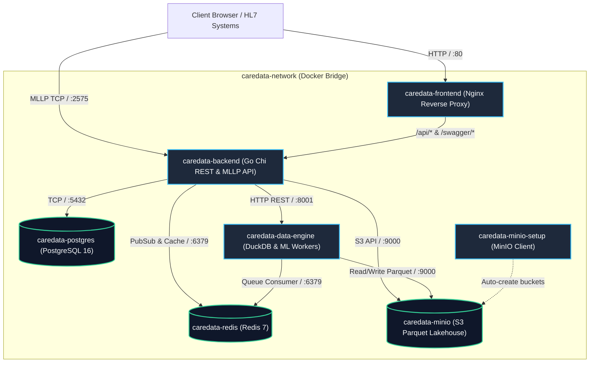

# CareData Intelligence — Enterprise Autonomous Clinical Intelligence & Lakehouse Platform

CareData Intelligence is a production-ready, HIPAA-compliant clinical data intelligence and automated Lakehouse platform. It provides real-time HL7/MLLP clinical ingestion, DuckDB/Polars columnar query execution, predictive machine learning pipelines (readmission risk, LOS estimation, medication anomalies), and Gemini-powered clinical natural language intelligence.

---

## 🏛 System Architecture & Container Topology

The platform is fully containerized across seven orchestrated microservices connected through an isolated internal bridge network (`caredata-network`):



---

## 📦 Containerized Services Specification

| Service | Technology | Base Image | Container Name | Host Port | Internal Port | Healthcheck |
| :--- | :--- | :--- | :--- | :--- | :--- | :--- |
| **Frontend** | React 18, Vite, Tailwind CSS, Nginx | `nginx:alpine` (Multi-stage) | `caredata-frontend` | `80` | `80` | `GET /` (wget spider) |
| **Backend** | Go 1.26/1.27, Chi Router, MLLP | `alpine:3.19` (Multi-stage CGO=0) | `caredata-backend` | `8080`, `2575` | `8080`, `2575` | `GET /api/v1/health` |
| **Data Engine** | Python 3.10, DuckDB, Polars, MLflow | `python:3.10-slim` | `caredata-data-engine` | `8001` | `8001` | `GET /health` |
| **Database** | PostgreSQL 16 Alpine | `postgres:16-alpine` | `caredata-postgres` | `5432` | `5432` | `pg_isready` |
| **Cache & Queue**| Redis 7 Alpine | `redis:7-alpine` | `caredata-redis` | `6379` | `6379` | `redis-cli ping` |
| **Object Store**| MinIO S3 Object Storage | `quay.io/minio/minio` | `caredata-minio` | `9000`, `9001` | `9000`, `9001` | `GET /minio/health/live`|
| **MinIO Setup** | MinIO Client CLI | `quay.io/minio/mc` | `caredata-minio-setup` | — | — | One-shot setup job |

---

## 🚀 Quickstart & Single-Command Deployment

### 1. Prerequisites
- Docker Engine `>= 24.0.0`
- Docker Compose v2 (`docker compose`)

### 2. Configure Environment
Copy the production environment template:
```bash
cp .env.example .env
```
*(Optionally provide your `GEMINI_API_KEY` or Snowflake credentials in `.env` if using cloud features).*

### 3. Deploy the Stack
Start all services in detached mode with automated health dependency sequencing:
```bash
./deploy.sh up
```
*Or using standard Docker Compose:*
```bash
docker compose up -d
```

### 4. Verify System Health
Check container state and healthcheck readiness:
```bash
./deploy.sh status
```

---

## 🌐 Platform Access & Port Map

Once launched, access the platform components through your browser or API clients:

- **Frontend Application**: [http://localhost](http://localhost) (or port configured in `FRONTEND_PORT`)
- **Backend REST API**: [http://localhost:8080/api/v1](http://localhost:8080/api/v1)
- **Interactive Swagger Docs**: [http://localhost:8080/swagger/index.html](http://localhost:8080/swagger/index.html)
- **Python Data Engine**: [http://localhost:8001](http://localhost:8001)
- **MinIO Storage Console**: [http://localhost:9001](http://localhost:9001) (User: `caredata_minio` / Pass: `caredata_minio_secret123`)
- **Real-time MLLP Ingestion Server**: `localhost:2575` (Raw TCP MLLP Stream)

---

## 🔑 Default Seed Accounts

The platform automatically initializes the schema and seeds standard test accounts on first boot:

| Role | Email | Password | Scope |
| :--- | :--- | :--- | :--- |
| **Super Administrator** | `superadmin@caredata.ai` | `Password123!` | System-wide configuration, tenant management, audit logs, lakehouse maintenance |
| **Hospital Administrator** | `admin@caredata.ai` | `Password123!` | Departmental acuity, cohort management, user management |
| **Senior Data Analyst** | `analyst@caredata.ai` | `Password123!` | Analytics workspace, SQL/DuckDB OLAP queries, data exports |
| **Clinical Viewer** | `viewer@caredata.ai` | `Password123!` | Read-only clinical dashboards and real-time patient charts |

---

## 🛠 Management CLI (`deploy.sh`)

Use the included management utility for maintenance and deployment:

```bash
# Build / rebuild all images using multi-stage caching
./deploy.sh build

# Launch the stack in background
./deploy.sh up

# View real-time aggregated logs (or specify service: ./deploy.sh logs backend)
./deploy.sh logs

# View running container status and healthchecks
./deploy.sh status

# Gracefully stop the stack
./deploy.sh down

# Destroy containers and persistent volumes (careful!)
./deploy.sh clean
```

---

## 🔒 Security & Production Best Practices

- **Non-Root Execution & Minimal Footprint**: Multi-stage Docker builds strip out compiler toolchains, package managers, and development artifacts.
- **Dynamic Reverse Proxy**: The frontend Nginx container proxies all `/api/*` and `/swagger/*` calls directly to the internal `backend:8080` service, eliminating CORS issues and hiding internal IPs.
- **Isolated Network**: All database, Redis, S3, and Python services communicate over the private Docker bridge network `caredata-network`. Only required public entrypoints are published.
- **Zero-Downtime Persistent Volumes**: Named Docker volumes (`caredata_postgres_data`, `caredata_redis_data`, `caredata_minio_data`, `caredata_mlflow_data`) preserve state across container upgrades.
